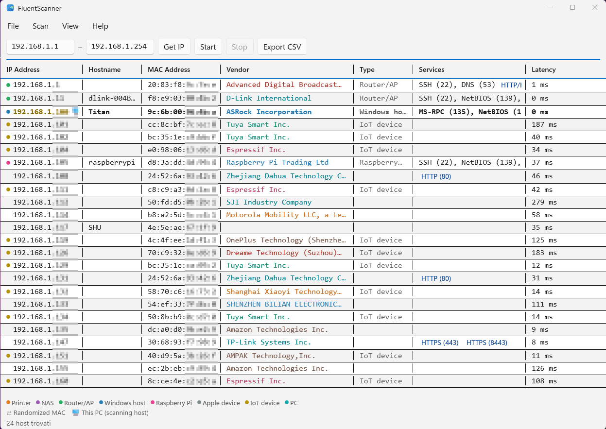

# FluentScanner

A LAN scanner: give it an IP range and it finds live hosts, their open
common services, MAC addresses and hostnames — two native builds from
one repo, same features on both platforms.

## Features (both platforms)

Same intents on both platforms — see the parity checklist in [AGENTS.md](AGENTS.md).

## Requirements

- Windows 10 1809+ (Mica on Windows 11). To build: .NET 8 SDK.
- macOS 14+, Apple Silicon. To build: Swift 6 toolchain.

## Download

The repo contains sources only (builds and setups are **not** versioned). Same
version number = same features on both platforms (see Changelog below).

- **Windows**: [Releases](../../releases) page → `FluentScanner-Setup-X.Y.Z-win-x64.exe`
  from a `windows-vX.Y.Z` release (per-machine install, requires the UAC prompt).
- **macOS**: [Releases](../../releases) page → `FluentScanner.dmg` from a
  `macos-vX.Y.Z` release → drag `FluentScanner.app` into Applications.
  First launch: right-click → Open (ad-hoc signature).

Or build it yourself: see `windows/AGENTS.md` (Build/run) and
`macos/AGENTS.md` (Build/run).

## Changelog

Same version number = same features everywhere. Windows is at `1.2.6`,
macOS at `1.2.4`.

- **1.2.6** — Windows: every IP gets every clue. Hosts seen only through
  the harvests (mDNS/UPnP speakers that ignore ping and every discovery
  port — e.g. voice assistants answering as `none`) now gain their MAC +
  vendor from a post-harvest ARP re-read, reverse DNS and NetBIOS over the
  full row set, a short 80/8080 knock, and the UPnP description
  (maker/friendly name) as a second brand fallback; the mDNS query burst
  goes out twice so flaky IoT responders are caught. The results header
  underline follows the theme (black/white) instead of the progress blue,
  and a spinner next to the status marks a running scan.

- **1.2.5** — Windows: results land live. Every ping/TCP discovery hit is on
  the table as soon as it answers (no waiting for the whole sweep), the
  hostname lookups merge chunk by chunk, and every lookup that needs a
  working resolver has a hard deadline — a network with no internet (an
  access point on its own) no longer leaves the scan hanging on something
  that can never arrive. The title-bar buttons (min/max/close) now follow
  the app theme instead of the OS one, so they stay visible when the app
  is dark and the system is light (and vice versa).

- **1.2.4** — macOS: the size-to-fit toolbar button works again (the 1.2.3
  cleanup had dropped the table rebuild that makes SwiftUI apply the
  fitted widths).

- **1.2.3** — macOS: a toolbar button fits every column to its contents
  (Cmd+Shift+F); the fitted set is pinched so it never overflows the
  window; the Settings window fits its longer localised labels. The
  per-column double-click shortcut is dropped — SwiftUI's table header
  never delivers it reliably; the button covers the need (Windows keeps
  its boundary drag/double-click as a bonus).
- **1.2.2** — Windows: resizing a column works like Excel — the pointer on
  the boundary between two headers turns into the resize cursor, dragging
  the boundary resizes the column, and a double-click on the boundary (like
  a double-click on the header title) sizes the column to its contents.
- **1.2.1** — Double-click a column header to size it to its contents (both
  platforms); Italian Get IP button now reads `Leggi IP` (as on Windows).
- **1.2.0** — Full parity, both platforms: click-to-sort column headers +
  text filter, editable discovery/service ports and ping/discovery/port
  timeouts in Settings, clickable HTTP/HTTPS services (the services cell
  renders as one truncating line on macOS), vendor and type in separate
  columns, double-click a header sizes it to its contents.
- **1.1.0** — Editable discovery/service ports + ping/discovery/port
  timeouts in Settings; click-to-sort columns + text filter; self-host
  highlight readable in both themes (amber on light, yellow on dark);
  Windows only: Mica window + standard menu bar, tabular results (zebra
  rows, column separators, resizable columns, clickable HTTP/HTTPS
  links), scan runs off the UI thread, Inno Setup installer. The Windows
  1.1.0 build shipped without sort/filter and the Settings tuning — those
  landed in 1.2.0.
- **1.0.0** — First stable: everything in 0.10.0, intents locked.
- **0.10.0** — Settings (Cmd+,): language override (system/EN/IT, live),
  table font size + monospaced toggle, light/dark/system theme.
- **0.9.0** — Help sheet (toolbar ? + Help menu) and a fuller About sheet
  (toolbar ⓘ + app menu, icon, version, credits); EN/IT audit: no missing
  or orphan keys.
- **0.8.4** — Footer legend also covers the scanning-host computer icon.
- **0.8.3** — Footer legend covers randomized MACs; wider IP column so
  the local-host icon doesn't clip the address.
- **0.8.2** — Start/end IP fields widened (were clipping the address).
- **0.8.1** — The self-highlight survived the ARP refresh: row rebuilds
  kept dropping the local flag (your .117 is yellow again).
- **0.8.0** — Editable scan range (start/end IP fields) + Get IP button
  filling the local subnet range.
- **0.7.2** — The scanning host's IP is yellow.
- **0.7.1** — HTTP services name the software: `HTTP/Caddy (80)`.
- **0.7.0** — All lookups overlap: ping + TCP discovery concurrently, and
  mDNS + reverse DNS + NetBIOS + HTTP concurrently. Same results, wall time
  ≈ the slowest pass instead of the sum.
- **0.6.3** — Randomized MACs are flagged (shuffle icon) and never blamed
  on a wrong vendor; the scanning host's whole row is now bold.
- **0.6.2** — Full IEEE OUI table (40k vendors instead of the 13k filtered
  subset): no internet lookup needed, works offline, no cache to maintain.
- **0.6.1** — The HTTP `Server:` header (Caddy, lighttpd…) fills the brand
  slot when the MAC vendor is unknown — only for already-open 80/8080.
- **0.6.0** — The scanning host is always listed and highlighted; five more
  OUI vendors (ADB, AMPAK, Dreame, SJI, Xiaoyi), new IoT/Router hints, and
  six more mDNS service types for names.
- **0.5.3** — Lost MACs fixed: `arp` prints non-padded groups (`f8:e9:3:0…`)
  and the parser rejected them. Both sides now zero-pad.
- **0.5.2** — CIDR scans skip the network (.0) and broadcast (.255)
  addresses; a /24 now probes 254 hosts.
- **0.5.1** — TTL 255 no longer means "Router/AP": measured on a real LAN,
  it's Tuya/Espressif embedded stacks. Only TTL 128 (Windows) stays as hint.
- **0.5.0** — App icon: hand-drawn radar sweep (blue tile, green sweep,
  two hosts found) as SVG source; `.icns` on macOS, `.ico` on Windows.
- **0.4.3** — Vendor brands each get their own stable color; footer legend
  for the device-type dots.
- **0.4.2** — Device-type color dot before each IP (printer/NAS/router/PC…);
  the generic "Linux host" TTL guess is gone (it explained nothing).
- **0.4.1** — Hostnames fixed: mDNS queries now carry the `.local` suffix
  (bare queries get zero answers) and the parser reads the A records in the
  additional section; NetBIOS node-status names Windows PCs without mDNS.
- **0.4.0** — Fewer missing MACs: responders whose ARP entry was lost get a
  targeted re-ping and an ARP re-read. New device hints: the ping reply TTL
  suggests Windows/Unix-Linux/router when no OUI or open port explains the
  host, and the vendor/type column now shows the type part on macOS too.
- **0.3.0** — Discovery starts with an ICMP ping sweep (unprivileged on both
  platforms, and it fills the ARP table for every responder): finds quiet
  devices that answer no TCP port; TCP probing becomes the fallback for
  ICMP-silent hosts. Wider discovery port list (+SSH/HTTPS/RDP/print) and
  longer timeouts tuned for Wi-Fi.

- **0.2.1** — Layout/lookup fixes: header/row columns now align (flexible
  columns get an explicit frame); the OUI prefix lookup matched the wrong
  key format so the Vendor column stayed empty.

- **0.2.0** — Results table gains a Vendor/Type column (OUI from the MAC,
  IEEE-derived bundled table + service-based hints: Windows host, Printer,
  NAS, Router/AP…); vendor in the CSV export. Discovery is 4× faster
  (all discovery ports probed in parallel) and results land progressively;
  phase status messages during the scan. Table header aligned with rows.

- **0.1.0** — Skeleton: target parsing (single IP / CIDR / range), TCP host
  discovery, open-port scan of a common-services list, MAC from the ARP
  table, reverse DNS, progress + stop, CSV export, EN/IT UI.

## License

MIT — see [LICENSE](LICENSE).
